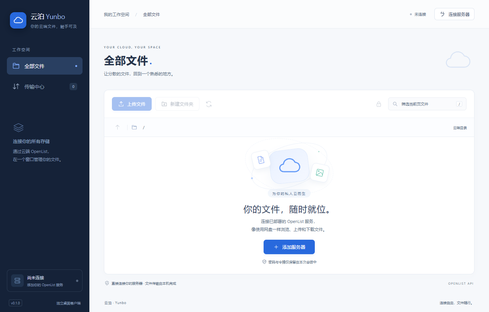

# 云泊 · Yunbo

用 Go + Wails 2 编写的 OpenList 桌面客户端，连接你已经部署的云端服务。在独立窗口中浏览、上传、下载和管理文件。支持 Windows 和 macOS，界面为中文。

云泊（Yunbo）是独立客户端，通过 HTTP API 与 [OpenList](https://github.com/OpenListTeam/OpenList) 通信，不包含 OpenList 服务端或存储驱动，与 OpenList Team 无官方关联。



截图使用本地测试服务中的示例目录。

## 下载安装

在 [GitHub Releases](https://github.com/xxay-16/yunbo/releases/latest) 下载：

| 系统 | 安装包 | 安装方式 |
| --- | --- | --- |
| Windows 10/11 x64 | `yunbo-版本-windows-amd64-setup.exe` | 安装到当前用户目录，创建桌面与开始菜单快捷方式；缺少 WebView2 时联网安装运行时 |
| Windows 10/11 x64 | `yunbo-版本-windows-amd64-portable.zip` | 解压后运行 `yunbo.exe`，需要 WebView2 |
| macOS 13+，Intel / Apple Silicon | `yunbo-版本-macos-universal.dmg` | 将「云泊」拖入 Applications |

每次版本发布附带 `SHA256SUMS.txt`。当前安装包没有商业代码签名，Mac 包作 ad-hoc 签名且未经过 Apple 公证；首次打开的来源提示可参照 [Apple 官方说明](https://support.apple.com/guide/mac-help/open-a-mac-app-from-an-unknown-developer-mh40616/mac)。卸载 Windows 版本会保留连接配置、续传记录与用户文件。

## 当前功能（v0.3.1）

- 账号密码登录、两步验证码、访问令牌、访客访问。
- 记住上次连接的服务地址、用户名、登录方式和起始目录。
- 支持反向代理子路径，例如 `https://example.com/openlist`。
- 文件夹浏览、路径跳转、分页（每页 100 项）、当前页筛选与排序。
- 新建文件夹、重命名、批量删除；按钮根据账号和目录权限启用，最终由服务器校验。
- 选择本机文件批量上传、选择保存目录批量下载、复制签名下载链接。
- 将本机文件或文件夹拖入文件列表区域，上传到当前云端目录；支持保留子目录和空文件夹，也可点击「上传文件夹」。
- 两个并行传输、进度、实时速度、预计剩余时间、排队、暂停、继续、取消和失败信息。
- 上传分片续传、下载 Range 续传；保存任务记录，重启后登录原服务器和账号即可手动继续。
- 流式传输，不把整个文件加载进内存。上传拒绝覆盖同名文件；下载完成后发布文件，同名文件自动编号。暂停和可续传失败保留临时数据，取消任务会清理。
- 为受保护目录输入访问密码，密码仅在当前会话保留。
- 紧凑文件管理布局：顶部导航、完整高度的文件列表、固定分页栏和可滚动的传输任务列表。
- 收进后台后保持连接并继续传输，托盘菜单可恢复窗口、打开配置目录或完全退出。

## 运行与构建

需要 Go 1.23+、[Wails 2](https://v2.wails.io/docs/gettingstarted/installation/) 及对应桌面依赖。Windows 需要 WebView2 Runtime。当前开发机已安装这些依赖。

```powershell
# 检查桌面环境
wails doctor

# 开发运行
.\scripts\dev.ps1

# 构建 Windows 程序
.\scripts\build.ps1

# 保留旧程序，另存新版
.\scripts\build.ps1 -OutputName yunbo-v0.3.0

# 后端测试和静态检查
go test ./...
go vet ./...
```

生成的程序位于 `build/bin/yunbo.exe`。前端使用原生 HTML/CSS/JavaScript，无需 npm 安装或前端构建步骤。Wails CLI 会生成绑定文件，运行时通过 Wails bridge 调用 Go。

脚本使用 `-skipembedcreate`：资源目录已在仓库中，无需 Wails 自动创建，同时避开 Wails 2.11 内置旧版 `x/tools` 在本机 Go 1.27 下的资源扫描错误。也可直接执行 `wails build -skipembedcreate` 或 `wails dev -skipembedcreate`。构建时保留输出目录中其他名称的程序。

### 安装包与自动发布

GitHub Actions 使用 Go 1.27 和 Wails 2.11，在 Windows 与 macOS runner 上构建。推送 `main`、提交 PR 或手动运行 [Build installers](https://github.com/xxay-16/yunbo/actions/workflows/build.yml) 后，可在该次运行的 Artifacts 下载产物（保留 14 天）。

本地打包命令，输出位于 `dist/`：

```powershell
# Windows，需要 NSIS 的 makensis 位于 PATH
.\scripts\package-windows.ps1
```

```bash
# macOS，需要 Xcode command line tools 和 Wails
bash scripts/package-macos.sh
```

发布新版时，先更新 `wails.json` 的 `info.productVersion` 和 `docs/release-notes.md`，提交后推送同名版本标签，例如 `git tag v0.3.0`、`git push origin v0.3.0`。标签必须与配置版本一致。两个平台测试和打包全部成功后，Actions 自动创建 Release，上传安装包、免安装包和校验值；普通分支构建不会创建 Release。

## 连接你的云端

1. 启动程序，点击「添加服务器」。
2. 填写服务根地址，例如 `https://cloud.example.com`。请勿填写 `/api`、`/dav` 或网页的文件夹地址；反向代理部署前缀需要保留。
3. 选择账号密码、访问令牌或访客登录。账号开启两步验证时填写验证码。
4. 起始目录默认为 `/`，相对于当前账号的可访问根目录。受保护的起始目录可在「高级设置」输入目录密码。
5. 连接后，点击文件夹名称进入；勾选文件即可下载、复制链接或管理。上传、下载时使用系统文件选择窗口。
6. 上传也可直接从文件管理器拖入文件或文件夹。拖放区域会显示当前目标目录；目录只读、正在切换目录或正在准备任务时暂停接收拖放。

首次运行会兼容读取旧版 `openlist-desk` 目录中的连接信息，成功连接后保存到新目录。连接信息保存在系统配置目录：Windows 通常为 `%AppData%/yunbo/profile.json`。**密码、访问令牌、验证码和目录密码不会写入磁盘**，退出后需重新登录。跨公网连接请使用 HTTPS；HTTP 仅适合你信任的网络环境。API 请求由 Go 发出，无需为本客户端开放浏览器 CORS。使用系统证书验证，不跳过 TLS 校验。

下载先通过 `/api/fs/get` 获取签名，再访问服务器 `/d/` 下载路由，支持存储重定向；下载请求不携带账号令牌。账号具有非 `/` 的 `base_path` 时，客户端会转换为下载路由所需的完整路径。复制的下载链接包含访问签名。

## 速度与断点续传

在「传输中心」查看每个任务的速度、进度和预计剩余时间。速度按最近约 5 秒的传输字节计算，续传时不计入以前完成的数据；校验文件、暂停及等待服务端确认期间显示 0 B/s。

- **上传**：服务端需要支持并启用 OpenList 分片上传接口，已按 v4.2.9 核对。客户端登录时自动检查能力；旧版或关闭此功能时使用普通上传，并说明不能暂停续传。已经开始的普通上传无法转为分片任务。
- **下载**：源服务器需要正确响应 HTTP Range。继续前重新获取下载链接，校验大小、修改时间、ETag/Last-Modified 和分段范围；文件变化或忽略 Range 时拒绝拼接。
- **暂停与重启**：可续传任务暂停、断开连接或关闭应用后保留记录。重新登录同一服务器和账号，再点击「继续」。受保护下载需重新输入目录密码。
- **上传有效期**：OpenList v4.2.9 的会话保存在服务端内存中，默认空闲 30 分钟过期，重启服务端也会丢失。云泊保持连接时每 5 分钟保活暂停的上传；离线过期或服务端重启后需要重新上传，客户端会明确报告原因。
- **源文件检查**：上传开始及继续时计算完整 SHA-256，避免把变化后的文件拼进原任务。Windows 上传期间锁定源文件，防止写入和删除。校验大文件时会显示校验进度。

任务元数据保存在 `%AppData%/yunbo/transfers.json`，包括本地路径、服务器、账号和续传会话 ID；不包含密码、令牌、目录密码或签名下载链接。下载的 `.yunbo-*.part` 文件位于所选保存目录，请勿在任务完成前修改或删除。「清除已结束」保留仍可继续的任务；要丢弃这些进度，请先取消任务。

## 后台运行与配置目录

点击右上角「收进后台」图标或窗口关闭按钮，窗口会隐藏，Go 传输队列和连接保活继续运行。Windows 单击托盘图标即可恢复；右键菜单提供「显示主窗口」「收进后台」「打开配置目录」「退出云泊」。Mac 的菜单栏云朵图标提供相同菜单，Cmd+Q 与 Dock 的退出仍会完全退出。原生最小化按钮保留系统默认行为。

再次启动同一配置目录下的云泊会唤回已有窗口。完全退出请选择「退出云泊」；退出时保存可续传任务，普通上传会中断。

在托盘菜单或「连接设置」中点击「打开配置目录」可直接查看本机文件：

| 系统 | 目录 |
| --- | --- |
| Windows | `%AppData%\yunbo`，通常为 `C:\Users\用户名\AppData\Roaming\yunbo` |
| macOS | `~/Library/Application Support/yunbo` |

`profile.json` 是连接设置，`transfers.json` 是传输记录。密码、令牌、验证码和目录密码不会写入这些文件。

## 代码结构

```text
main.go                  Wails 窗口与静态资源
app.go                   Wails 桥接、原生文件选择窗口
internal/clientapp/      连接会话、上传预检及文件夹上传规划
internal/openlist/       HTTP API、登录哈希、流式上传下载
internal/config/         不含凭据的连接配置
internal/transfer/       并发队列、速度、断点记录、暂停续传与文件发布
frontend/                中文桌面界面
docs/architecture.md     接口、约束和后续路线
```

## 当前边界

当前版本没有本地目录自动同步、虚拟磁盘挂载、整文件夹下载或自启动。不支持续传的普通传输在断开连接、切换服务器或完全退出应用时取消。取消上传时，远端存储是否保留已经接收的内容由 OpenList 和存储驱动决定。服务端可能分批执行批量删除，遇到失败时应刷新目录核对实际结果。

拖放使用 Wails 的系统文件路径解析，仅在桌面程序中可用；普通浏览器预览不支持拖放上传。单次上传会先检查本机路径、同名目标冲突和剩余队列容量，最多保留 200 个传输记录，文件夹扫描上限为 4096 个项目。不跟随符号链接；队列满时请先清除已结束任务。同名远端文件仍拒绝覆盖。

接口已依照 OpenList 上游源码核对，并使用本地 HTTP 测试服务验证。已确认目标云端实例升级至 v4.2.9 且启用分片上传；暂停、重启、续传和内容一致性使用本地测试文件验证，尚未进行真实云盘的大文件长时间续传测试。

## Git

GitHub 仓库：[xxay-16/yunbo](https://github.com/xxay-16/yunbo)。

构建产物、日志和本地环境文件不会提交。

```powershell
git clone https://github.com/xxay-16/yunbo.git
cd yunbo
.\scripts\dev.ps1
```
