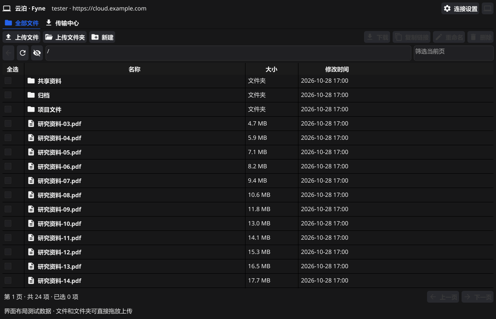

# 云泊 · Fyne 原生界面分支

此分支为 `feat/fyne-ui`，使用 **Fyne 2.8.2** 绘制 Go 原生界面。`main` 分支及已有正式发行版继续使用 Wails，未被此分支替换。



截图由 Fyne 软件渲染器使用布局测试数据生成；程序没有内置示例文件或假容量。

## 已接入

- 账号密码、OTP、令牌和访客连接；支持 OpenList 部署子路径和目录密码。
- 文件表格、文件夹导航、路径跳转、每页 100 项、当前页筛选、名称/大小/修改时间排序和复选。
- 选择文件上传、文件夹递归上传、窗口拖放多个文件或文件夹；保持原目录结构与冲突预检。
- 选择保存目录批量下载、新建目录、重命名、删除确认、复制签名下载链接。
- 传输中心：速度、剩余时间、进度、暂停/继续、取消、失败详情、重启恢复。
- Fyne 自带的跨平台托盘菜单，关闭窗口后继续传输；托盘可显示窗口、打开配置目录或退出。
- 网络、磁盘与 SHA-256 工作在后台运行，控件更新使用 Fyne 的 UI 调度；复用原来的 Go 服务层。
- 系统字体回退显示中文，跟随系统明暗主题，表格和进度条使用紧凑布局。

## 运行

需要 Go 1.23+（CI 使用 1.27）、C 编译器和 OpenGL 环境。Windows 需要 MinGW GCC 位于 PATH；Mac 需要 Xcode command line tools。此版本不需要 WebView2、Node 或 Wails CLI。

```powershell
# Windows 开发运行
.\scripts\dev.ps1

# Windows 原生程序，输出 build/bin/yunbo-fyne.exe
.\scripts\build.ps1

# 测试与检查
go test -race ./...
go vet ./...
```

```bash
# Mac 开发运行
go run .

# Intel / Apple Silicon 通用 DMG，输出 dist/
bash scripts/build-fyne-macos.sh
```

[Fyne 分支构建](https://github.com/xxay-16/yunbo/actions/workflows/fyne.yml) 在推送本分支时构建 Windows 免安装 ZIP 和 Mac 通用 DMG，产物保留 14 天。预览构建不会覆盖正式版 Releases。Mac 使用 ad-hoc 签名，未做 Apple 公证。

## 配置与并行试用

Fyne 版本单独保存在 Windows `%AppData%\yunbo-fyne`、Mac `~/Library/Application Support/yunbo-fyne`。`profile.json` 保存连接设置，`transfers.json` 保存传输断点，不保存密码或访问令牌。

首次连接会读取原 `yunbo/profile.json` 中的非敏感连接信息作为默认值，不导入或修改 Wails 版传输队列。每个 Fyne 配置目录只允许一个进程写入；再次运行时会提示从托盘恢复现有窗口。

## 分支结构

- `main_fyne.go`：默认原生入口、图标、单实例和配置隔离。
- `internal/nativeui/`：连接对话框、文件表格、任务列表、主题和界面测试。
- `internal/clientapp/`、`internal/openlist/`、`internal/transfer/`：与 Wails 版本复用的业务代码。
- `main.go`、`app.go`、`desktop.go` 和 Web 静态文件保留作对照，只有 `wails` 构建标签启用时才进入程序；Windows 对照构建使用 `scripts/build-wails.ps1`。

## 当前边界

Fyne 的文件选择器一次选择一个文件；多文件请拖放或选择文件夹。没有目录自动同步、整文件夹下载、自动登录或开机启动。上传续传依赖 OpenList 服务端分片能力及会话有效期，下载续传依赖源端 Range 支持。

自动化覆盖共享后端、界面复选回收、只读权限、目录密码边界、排序、单实例和 1180×760 / 940×640 布局。尚未在用户真实云盘和 Mac 上完成交互验收。

Wails 版本的原说明见 [docs/wails-readme.md](docs/wails-readme.md)。